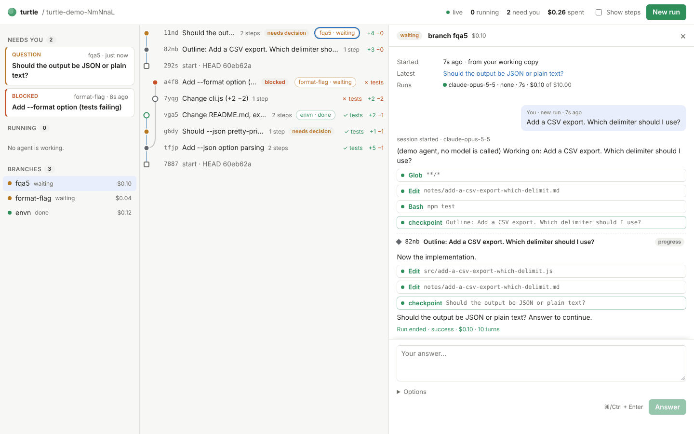

# turtle

A human–AI interface and version-control layer for AI coding agents: every step an agent takes becomes a checkpoint in a tree you can inspect, fork, and steer.

Status: Phase 0 (recording layer) and Phase 1 (web UI) implemented; next is the task graph, a mind map of tasks shared by humans and agents ([docs/phase2-spec.md](docs/phase2-spec.md), architecture v0.3). Design: [docs/architecture.md](docs/architecture.md), [docs/phase0-spec.md](docs/phase0-spec.md), [docs/phase1-spec.md](docs/phase1-spec.md). **Hands-on test guide: [docs/tutorial.md](docs/tutorial.md).**



## Try it

Requires Node.js ≥ 22, pnpm, git ≥ 2.31, and optionally Docker (for `--sandbox docker`). Agents need Claude credentials in the environment: `CLAUDE_CODE_OAUTH_TOKEN` (run `claude setup-token`, for subscriptions) or `ANTHROPIC_API_KEY`.

```bash
pnpm install
pnpm build
pnpm demo:ui                  # offline: a demo tree in the web UI, with scripted agents
pnpm demo                     # the same tree, shown with the CLI
pnpm docker:build             # runner image for --sandbox docker
```

In any git repository:

```bash
alias turtle="node /path/to/turtle/packages/cli/dist/main.js"
turtle init                                   # creates turtle.config.json
turtle ui                                     # web UI at http://127.0.0.1:4317
turtle run "Add a --json flag to the exporter"
turtle status                                 # what is running, what waits for you
turtle run --from <node> "Yes, pretty-print"  # answer a question / continue a branch
turtle run --from <node> --fork "Try another way"
turtle log                                    # the tree (--all adds micro snapshots)
turtle show <node> --diff --transcript
turtle export <node> --branch feat/json       # one normal git commit on your HEAD
turtle doctor && turtle stats --criteria
```

Press Ctrl-C once to interrupt an agent (its work is kept as a `killed` checkpoint), twice to kill it.

## Development

```bash
pnpm test             # vitest (no API key needed: a scripted FakeRunner speaks the real protocol)
pnpm lint             # biome
pnpm typecheck
pnpm bench:snapshot   # snapshot latency on a synthetic 10k-file repo
pnpm e2e              # real API run with Haiku: new → need_decision → continue → fork (~$0.02)
pnpm docker:smoke     # docker sandbox mechanics, no API calls
pnpm ui:smoke         # headless Chromium drives the demo UI end to end (needs a global playwright)
pnpm --filter @turtle/web dev   # UI dev server proxying to `turtle ui --port 4317`
```

| Package | Purpose |
|---|---|
| `packages/protocol` | Orchestrator ↔ runner message types and JSONL framing |
| `packages/core` | Git store, SQLite, run orchestration, checkpoint rules, summarizers, sandboxes |
| `packages/runner-claude` | `turtle-runner`: Claude Agent SDK runner (runs inside the sandbox) |
| `packages/server` | `turtle ui` HTTP/SSE server; also starts runs from the browser |
| `packages/web` | The web client (React + Vite) |
| `packages/cli` | The `turtle` command |
