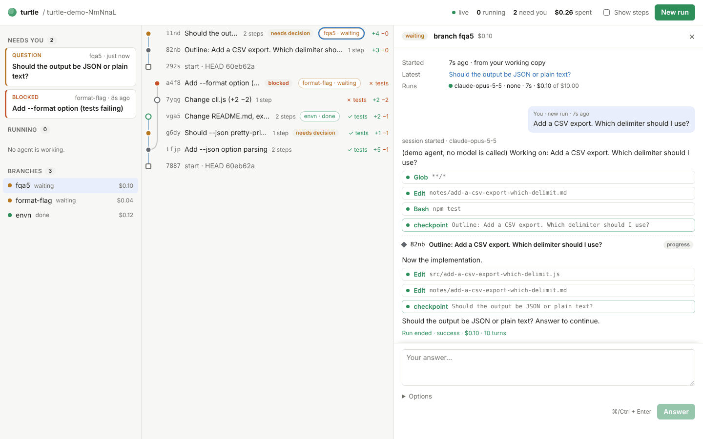

# turtle — Hands-on Test Guide (macOS)

This guide walks you through testing turtle Phase 0 and Phase 1 on your own Mac: first with a scripted agent (no credentials), then with real Claude agents on a practice repository. It takes about 45 minutes. At the end there is a checklist to report back.

What you will see: every agent becomes a **branch**. Every checkpoint it makes becomes a **node** in a tree. You can answer its questions, fork from any node, stop it, and inspect what changed, all from a web page.



---

## 1. Install the prerequisites

You need Node.js 22 or 24, pnpm, git, and the Claude Code CLI (only to create a login token).

```bash
xcode-select --install
```
This installs Apple's command-line tools: git and a C compiler, which one native module may need. If they are already installed, it says so.

```bash
brew install node@24
```
Or use nvm or fnm. Without Homebrew, install Node 24 LTS from nodejs.org. Then add it to your PATH:

```bash
echo 'export PATH="/opt/homebrew/opt/node@24/bin:$PATH"' >> ~/.zshrc && source ~/.zshrc
```

```bash
npm install -g pnpm
```

Check the versions:

```bash
node --version && pnpm --version && git --version
```
You should see Node v22 or v24, pnpm 10.x, and git 2.31 or newer (Apple's git 2.39 is fine).

If `claude --version` does not work, install Claude Code (see https://code.claude.com/docs). You only need it for `claude setup-token` in Part B.

## 2. Get and build turtle

```bash
mkdir -p ~/src && cd ~/src
```

```bash
git clone https://github.com/ccderek/turtle.git && cd turtle
```

Until the Phase 1 pull request is merged into `main`, use its branch:

```bash
git checkout claude/ai-vcs-architecture-discussion-mkf8dd
```

```bash
pnpm install && pnpm build
```

`pnpm install` downloads dependencies, including SQLite already compiled for your Mac; nothing is compiled on your machine. `pnpm build` compiles everything, including the web client.

Make a `turtle` command:

```bash
echo 'alias turtle="node $HOME/src/turtle/packages/cli/dist/main.js"' >> ~/.zshrc && source ~/.zshrc
```

```bash
turtle --help
```

---

## Part A — Offline demo (no credentials, about 10 minutes)

```bash
cd ~/src/turtle && pnpm demo:ui
```

This creates a throwaway repository in a temporary folder (its path is printed as `demo repo:`), records three scripted runs into it (one asks a question, one is answered, one fork gets blocked), and opens http://127.0.0.1:4317. New runs started from the browser use a **demo agent**: no model is called, and it takes about 10 s. The demo agent reacts to the words in your prompt:

| Your prompt contains | The demo agent ends with |
|---|---|
| a `?`, or "should", "which", "ask" | a question for you (needs decision) |
| "fail" | failing tests (blocked) |
| anything else | done |

The page opens on the **Tasks** tab (the task graph, Part D). Part A is about the **Code** tab: click **Code** at the top first.

Try these, and tick each check (A1–A8) as you go:

1. **A1. Read the screen.**
   - Left: *Needs you* (one blocked item), *Running*, *Branches*.
   - Center: the tree, newest at the top. The lower lane is the first run; the curved lane is the fork.
   - Filled circles are checkpoints the agent declared. Hollow circles are automatic ones. Squares are starting points (your files at that moment).
2. **A2. Open the blocked item.**
   - Click it in *Needs you*. The right panel shows the summary, *Source*, *Changes*, *Tests* and *Cost*.
   - Open the *Changes* and *Steps* tabs. *Steps* is the conversation that led to this checkpoint; click a tool call to see its input and result.
3. **A3. Start a run.**
   - Click **New run** and type `Add a CSV export. Which delimiter should I use?`.
   - Watch the branch panel: tool calls appear one by one, a checkpoint divider appears, and a new lane grows in the tree with a pulsing head.
4. **A4. Answer it.**
   - When it stops, a *Question* card appears in *Needs you* (the tab title also shows a count).
   - Click it, type an answer and press **Answer** (or ⌘+Enter). The same branch continues.
5. **A5. Fork.**
   - Click the "Outline: …" checkpoint of that run, choose **Fork from here**, and type `Try TSV instead`.
   - A new lane curves off that node.
6. **A6. Stop.**
   - Start another run (`A long refactor`) and press **Stop agent** in its branch panel.
   - The branch becomes *stopped*, and its work so far is kept as a checkpoint.
7. **A7. Show steps.**
   - Tick **Show steps** (top right). Every tool call becomes a small dot in the tree. Untick it again.
8. **A8. Save and export.**
   - On any checkpoint, open **Save & export**.
   - Save a snapshot named `v1`; a flag appears on the node.
   - Export as git branch `try/export`. Check the branch in a terminal:

```bash
git -C <demo repo path> log --oneline try/export
```
Replace `<demo repo path>` with the path printed as `demo repo:` when the demo started.

Press Ctrl-C in the terminal to stop.

---

## Part B — Real agents on a practice repository (about 30 minutes)

### B0. Credentials

turtle gives every agent its own Claude config folder, so your normal `claude` login (stored in the macOS Keychain) is **not** visible to agents. Pass a token through the environment instead.

**With a Claude subscription (Pro/Max):** generate a token. It opens the browser to log in and prints a token starting with `sk-ant-oat…`:

```bash
claude setup-token
```

Then add it to your shell:

```bash
echo 'export CLAUDE_CODE_OAUTH_TOKEN="paste-the-token-here"' >> ~/.zshrc && source ~/.zshrc
```

**With an API key instead:**

```bash
export ANTHROPIC_API_KEY="sk-ant-…"
```

An API key also enables the Haiku summarizer for automatic checkpoints. With only the OAuth token, automatic checkpoints get plain summaries, which is fine for this test.

`turtle doctor` (inside a repository) tells you whether credentials are visible.

### B1. A practice repository

Create the folder:

```bash
mkdir -p ~/turtle-playground/src ~/turtle-playground/test && cd ~/turtle-playground && git init -q
```

Create a minimal `package.json`:

```bash
cat > package.json <<'EOF'
{ "name": "playground", "type": "module", "scripts": { "test": "node --test" } }
EOF
```

Add a small module:

```bash
cat > src/text.js <<'EOF'
export function capitalize(s) {
  return s.charAt(0).toUpperCase() + s.slice(1);
}
EOF
```

Add a test for it:

```bash
cat > test/text.test.js <<'EOF'
import { test } from "node:test";
import assert from "node:assert/strict";
import { capitalize } from "../src/text.js";

test("capitalize", () => assert.equal(capitalize("turtle"), "Turtle"));
EOF
```

Commit it:

```bash
git add -A && git commit -qm "playground" && npm test
```

Initialize turtle. Without Docker installed, it picks `sandbox: none`; agents then run as normal processes in their own copy of the files under `~/.turtle/workspaces/`:

```bash
turtle init
```

Check that git, the database and credentials agree:

```bash
turtle doctor
```

Optional: choose a model by editing `turtle.config.json`, for example `"agent": { "model": "claude-sonnet-5-5", "maxBudgetUsd": 2 }`. You can also set it per run under **Options** in the UI. Start the UI:

```bash
turtle ui
```

Leave this terminal open. The page opens at http://127.0.0.1:4317.

### B2. A run that asks you something

Click **New run** and paste:

> Add a `slugify(text)` function to src/text.js with tests in test/text.test.js. Before you decide how to treat accented letters like "é", ask me with a checkpoint.

Watch:
- the branch panel fills with the agent's messages and tool calls;
- a checkpoint lands in the tree;
- *Needs you* shows a **Question**. **Check U1:** this should happen within about a second of the agent asking.

### B3. Answer it

Click the question and answer:

> Transliterate them: "é" becomes "e". Then run the tests.

The same branch continues, and the agent remembers the conversation. When it is done, open its last checkpoint:
- *Changes* shows the diff since the previous checkpoint;
- *Steps* shows what it did;
- *Tests* should say passing. **Check U2** and **U5.**

### B4. Fork from the middle

Click the first checkpoint of that branch, choose **Fork from here**, and type:

> Instead, keep accented letters as they are and only lowercase and replace spaces with "-".

A new lane appears. In its branch panel, the agent should behave as if it remembers the original task up to that checkpoint, but not your later answer. **Check U3.**

### B5. A terminal run shows up live

Open a **second** terminal and run:

```bash
cd ~/turtle-playground && turtle run "Add a truncate(text, n) function with tests"
```

The new branch appears in the browser while it works. Press **Stop** on it in the browser. The terminal run should end with `killed`, and the branch shows *stopped*. **Check U4.**

### B6. Two at once

Start two runs from the browser, a few seconds apart. For example:
- "Add a `reverseWords(text)` function with tests"
- "Write a README.md for this project"

While both run, can you tell at a glance what each one is doing and whether anything needs you? This is the main question of Phase 1. **Check U6.**

### B7. Take a result out

On the checkpoint you like best, use **Save & export → Export as git branch** with `feat/slugify`. Then, in a terminal:

```bash
git log --oneline --all -5 && git diff main feat/slugify --stat
```

The export is one normal commit on top of the commit the run started from. Your working copy was never touched.

### B8. Phase 0 checks from the CLI

```bash
turtle log
```
The same tree as text.

```bash
turtle status
```

```bash
turtle stats --criteria
```
Phase 0 criteria E1–E6. Some need longer runs and may show `?`.

```bash
turtle doctor
```
This should end with "git and the database agree".

Stop the UI with Ctrl-C in its terminal.

---

## Part D — The task graph (offline, about 25 minutes)

Use the same `pnpm demo:ui` as Part A (start it again if you stopped it). The **Tasks** tab shows a seeded example: a friend's trading system. One approach to the investment signal (A, news sentiment) was tried, failed out of sample and was abandoned. Its lesson sits on the *Investment signal* node, and approach B starts from the checkpoint before A. The demo agent works in small steps (about 5 s per task) and calls no model.

| A task's title or text contains | The demo agent |
|---|---|
| a `?`, or "which", "should", or a line `Ask the user: …` | asks you a question (with options) |
| "fail" or "wrong" | records a finding and ends blocked |
| anything else | records a finding with a CSV as evidence, a decision and a brief, then ends done |

1. **D1. Read the map.**
   - Each goal is a mind map: the goal on the left, its tasks to the right, subtasks further right. The coloured stripe on a card is its status. Findings, decisions and outputs are counted on the card ("1 finding · 1 output"); lessons and open questions are small nodes of their own.
   - *Approach A* is struck through (abandoned, kept in the record). The purple **lesson** next to it is what every task under *Investment signal* must follow.
   - Dashed arrows are dependencies. Point at *Schedule*: its arrows light up (it waits for B, and *Go live* waits for it).
   - **Outline** in the toolbar shows the same graph as an indented list, with every finding as its own row. A phone always gets the outline.
2. **D2. B starts on its own.**
   - Within a few seconds *Approach B* turns **running** (auto-start is ticked in the toolbar). Click it. The panel shows *Starts from* (the checkpoint before A) and *Lessons this task follows*.
3. **D3. Tell it something while it works.**
   - Quickly, while B is still running, type `Also log every trade to a CSV` under **Tell the agent** and press **Send**.
   - A decision "Following the user's message: …" appears under *Under this task*. If B finished first, press **Continue** with the same text instead.
4. **D4. Watch Activity.**
   - When B is done, *Schedule* starts, then *Go live*. Each agent action shows up in *Activity* on the left with a blue `new` mark. Nothing asks you to approve it.
5. **D5. Answer.**
   - *Go live: which exchange account should we use?* ends with a question in *Needs you*. Click it, then click one of the two options. The task continues and ends done.
6. **D6. The phone scenario.**
   - Click **New goal**, type `Measure power and performance of model A on a phone`, keep "Let a planner agent split it into tasks" ticked, and press **Add goal**.
   - *Plan the work* creates five tasks: *Connect the phone and set up the environment*, *Compile model A* and *Write the test plan* start at once (three in parallel, the cap). *Record a trace* waits for the environment; *Measure power and performance* waits for all three. Their cards say what they wait for.
   - *Measure* asks you which sampling rate to use. Answer **10 kHz** in *Needs you*.
7. **D7. What a task did.**
   - Click *Measure power and performance*. **Outputs** shows the CSV it measured, as a table, and the finding it supports. **Conversation** shows the prompt it got and every step. **Code** lists its checkpoints; click one to see its diff in the Code tab.
8. **D8. A hardened step, replayed for model B.**
   - When *Compile model A* is done, its card shows **⚙ hardened**. Open it: under **Recipe**, *Compile a model for the phone* is **verified**. turtle replayed `bash build/compile.sh` from a clean copy of the checkpoint (with the output deleted first) and got the same `build/model-A.bin`. *Measure power and performance* is hardened too, with numbers compared within 3%.
   - Press **Replay with…**, set `MODEL` to `B`, and press **Replay**. A task *Compile model A for the phone (MODEL=B)* starts. Its first run is the recipe itself, with no model.
   - It fails: the toolchain cannot lower Conv3D for model B. The task's *Replay* section shows the output, and an agent takes over with only that failure to fix. It changes `build/compile.sh` and records an updated recipe, which is verified in turn. Look at its *Conversation* tab: the first run is one Bash step and no model; the second is the agent.
   - **Replay a whole task.** On *Measure power and performance*, press **Replay…**, choose *The same start as before*, set `RATE` to `1k`, and press **Replay**. The new task applies the original's code changes and reruns the measurement with the recipe, with no model; its *Replay* section lists each step. *Your repository as it is now* does the same on today's code; a step that no longer applies goes to an agent with only what is left.
   - **Replay a chain.** Press **Replay…** on *Measure power and performance* again. Under **Upstream tasks**, check *Compile model A for the phone* and press **Replay 2 tasks**. Two replay tasks appear: the compile replay runs first, and the measurement replay waits for it ("waiting for …") and then runs. The *Replay* section of each shows the whole chain. In a backtest pipeline (data → signal → backtest), this is how you rerun everything with another date range: the date is a parameter of the data task's recipe.
9. **D9. Model B from the environment, by hand.**
   - Click *Compile model A for the phone*. Under **New task from here**, type `Compile model B with the new toolchain` and press **Add**. The new task starts from A's latest checkpoint (the `from …` badge), with A's files already there.
   - Press **Abandon…** on it, write `The new toolchain needs the vendor's NPU driver; check the driver first.`, and press **Abandon and keep the lesson**. The lesson appears on the goal: every later task under it gets it in its prompt.
   - On any task's *Overview*, **+ wait for a task** adds a dependency (turtle refuses one that would make a loop), and × removes it.
10. **D10. A lesson that is enforced.**
   - Back in the trading goal, the teal **check** under *Investment signal* is the lesson "keep 6 months out of sample" written as a script (`check_oos.py`). Click it to read the script.
   - turtle ran it at every checkpoint of *Approach B*. Open B, and look at *Activity* and the *Conversation* tab: the first "done" checkpoint failed the check, the agent was told why, added the out-of-sample score and passed. B's card shows **✓ checks**.
   - Click the lesson you wrote in D9 (the NPU driver), press **Enforce with a check…**, and add the check. Every later task under that goal is judged by it: a task cannot end done while a check fails, and the agent cannot edit the check.
11. **D11. Undo and the Code tab.**
   - Open any task, expand **History** and press **undo** on a change.
   - The *Code* line in a task's panel opens that task's branch in the **Code** tab: the same checkpoints and diffs as Part A.

**With real agents.** In your practice repository from Part B, run `turtle ui` (without `--demo-agent`). The repository gets a project in `~/.turtle/projects/<name>`. Click **New goal** and give it a small, real goal. The planner and the tasks are Claude Code agents, so they cost money (set `maxBudgetUsd` in the project's `turtle-project.json` under `defaults`). Untick *Auto-start ready tasks* if you want to start each task yourself.

---

## Part E — Your real task: the gate (M9, a week or two)

This is the test that decides whether turtle moves on to parallel work and to several people (Phase 3 and 4). You work as usual; turtle measures itself from what it recorded. Nothing asks you to fill anything in, except judging three exports.

1. **E1. Pick a real task.** One that takes days, where things fail and you change direction: for example the phone power measurement, or turtle itself (below).
2. **E2. Start it.**
   - Credentials: `claude setup-token`, then set `CLAUDE_CODE_OAUTH_TOKEN` (or `ANTHROPIC_API_KEY`). The audit (E5) needs `ANTHROPIC_API_KEY`.
   - In the repository: `turtle init`, then `turtle ui`. In the project's `turtle-project.json`, under `defaults`, set a low `maxBudgetUsd` at first; use `"sandbox": "none"` when a step needs your hardware (a phone over USB).
   - Click **New goal**. Untick *Auto-start ready tasks* if you want to start each task yourself at first.
3. **E3. Work with it.** Answer questions in *Needs you*, tell running agents when they go the wrong way, abandon what does not work and keep the lesson, enforce the lessons that matter with a check, and let steps that work become recipes.
4. **E4. Judge three exports.** On three tasks or goals that you would really send to someone: **Share as a file…**, download, read it, tick what is clear, and **Record my judgment** (or `turtle share <id> --judge yyyy`).
5. **E5. Run the audit.** `turtle audit` (about $0.001 per task with Haiku) checks each finished task's findings, decisions and status against its tool log.
6. **E6. Read the gate.** The **Gate** button, or `turtle stats --gate`. Also run `pnpm e2e:rewind` once in your turtle checkout (a few cents): it forks a real run from three checkpoints. Send the output of `turtle stats --gate`, and what got in your way.

**Using turtle to build turtle.** It works, with three things to know:
- The agents never touch your checkout or the turtle you are running: each task works in its own copy under `~/.turtle/workspaces`. To bring a result back, take its checkpoint out as a branch (`turtle export <node> --branch <name>` in the turtle repository, or the Code tab's *Save & export*), then review and merge it like any branch.
- A fresh copy has no `node_modules`. In the turtle repository's `turtle.config.json`, set `"workspace": { "setupCommand": "pnpm install --frozen-lockfile" }` so that agents can build and run the tests. A check such as `pnpm -s typecheck && pnpm -s test` on the goal makes "done" mean "tests pass".
- Run the turtle you use from a separate checkout (or a built copy) from the one you work on, so a half-finished change never breaks the tool you are using.

---

## Part C — Optional: Docker sandbox

If you install Docker Desktop or OrbStack, agents can run in containers that cannot see your `.git`. Build the runner image:

```bash
cd ~/src/turtle && pnpm docker:build
```

In `~/turtle-playground/turtle.config.json`, set `"sandbox": { "mode": "docker" }`. Or pick **docker** under **Options** for a single run. Repeat B2 and B4. `CLAUDE_CODE_OAUTH_TOKEN` and `ANTHROPIC_API_KEY` are passed into the container by name.

---

## What to report back

Copy this into the feedback thread:

```
Mac: (chip, macOS version)   Node: (version)   Auth: subscription token / API key
Part A:  A1 [ ]  A2 [ ]  A3 [ ]  A4 [ ]  A5 [ ]  A6 [ ]  A7 [ ]  A8 [ ]
Part B:  U1 [ ]  U2 [ ]  U3 [ ]  U4 [ ]  U5 [ ]  U6 [ ]   B7 export [ ]   B8 doctor OK [ ]
Part C:  (skipped / worked / problem)
Part D:  D1 [ ]  D2 [ ]  D3 [ ]  D4 [ ]  D5 [ ]  D6 [ ]  D7 [ ]  D8 [ ]  D9 [ ]  D10 [ ]  D11 [ ]
Part E:  task: (what)   days: (n)   exports judged: (n)   gate: (paste `turtle stats --gate`)

1. Could you keep up with what the agents were doing? Where did you lose track?
2. What did you look for on screen and not find?
3. Were the checkpoint summaries useful? Too many / too few checkpoints?
4. Anything confusing about continue vs fork?
5. Task graph: could you tell what each agent did and why, without opening the Code tab? Was the map or the outline easier to follow?
6. Bugs (what you did, what happened, screenshot):
```

For bugs, also attach:
- the output of `turtle doctor`;
- the agent log in `~/turtle-playground/.git/turtle/logs/` (the newest file);
- the error text from the terminal running `turtle ui`.

## Troubleshooting

| Symptom | Fix |
|---|---|
| `pnpm install` fails at `better-sqlite3: Running install script` | Your checkout is older than this fix: `git pull`, then `rm -rf node_modules && pnpm install`. better-sqlite3 ships compiled binaries and no longer needs a compiler |
| A run fails at once with "Not logged in" or "authentication" | The agent sees no credentials. Run `echo $CLAUDE_CODE_OAUTH_TOKEN` in the terminal that runs `turtle ui`, then restart `turtle ui` after `source ~/.zshrc` |
| "port 4317 is in use" | Another `turtle ui` is running. Stop it or use `turtle ui --port 4318` |
| The page says *offline* | The `turtle ui` process stopped. Start it again; the page reconnects by itself |
| An agent does not stop | Press **Stop** again: the second press kills it. The work so far is kept |
| "docker image … not found" | Build it with `pnpm docker:build`, or use sandbox `none` |
| A branch is stuck in *running* after a crash | Run `turtle doctor`. It marks dead agents as failed |
| Start over in a repository | `rm -rf .git/turtle` removes turtle's state for this repository, and `rm -rf ~/.turtle/workspaces` removes agent working copies for all repositories. Your files and git history are not affected |
